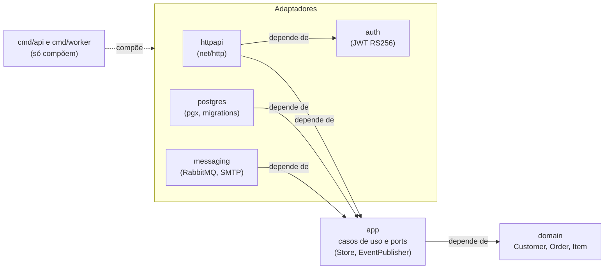
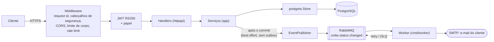

# go-order-api

API de pedidos em Go, implementando a especificação do `fastapi-order-api` (`DOMAIN.md` e catálogo de erros daquele projeto) com as convenções da linguagem: `net/http`, `log/slog`, `pgx`, interfaces pequenas declaradas por quem as consome e testes em tabela.

- **API** (`cmd/api`): clientes e pedidos, PostgreSQL, JWT RS256.
- **Worker** (`cmd/worker`): consome `order.status.changed` no RabbitMQ e envia e-mail por SMTP.

## Rodando

```sh
mkdir keys   # coloque aqui jwt_public.pem (chave pública RSA do emissor dos tokens)
docker compose up --build
```

API em `http://127.0.0.1:8080`, e-mails capturados no Mailpit em `http://127.0.0.1:8025`. Todas as portas escutam apenas em `127.0.0.1`.

Sem Docker: `DATABASE_URL=... JWT_PUBLIC_KEY_PATH=... JWT_AUDIENCE=... JWT_ISSUER=... go run ./cmd/api`. As migrations são aplicadas na partida (com lock consultivo, seguro com várias réplicas).

## Configuração

| Variável | Padrão | Observação |
|---|---|---|
| `APP_ENV` | `development` | `production` liga as validações estritas abaixo |
| `HTTP_ADDR` | `:8080` | |
| `DATABASE_URL` | | obrigatória |
| `JWT_PUBLIC_KEY_PATH` | | obrigatória na API |
| `JWT_AUDIENCE`, `JWT_ISSUER` | | obrigatórias na API; ver ADR 0003 |
| `CORS_ORIGINS` | vazio | lista separada por vírgula; em produção não pode ser vazia nem `*` |
| `MAX_BODY_BYTES` | `1048576` | conta também corpos *chunked* |
| `RATE_LIMIT_PER_USER` / `_WRITES` / `_PER_IP` | `120` / `30` / `600` | por minuto; `/health` é isento |
| `BROKER_URL` | | sem ela a API não publica eventos; em produção precisa ser `amqps://` |
| `SMTP_HOST`, `SMTP_PORT`, `SMTP_USER`, `SMTP_PASSWORD`, `SMTP_FROM` | porta `587` | worker; em produção STARTTLS é obrigatório |
| `SHUTDOWN_TIMEOUT_SECONDS` | `15` | |

Em produção a API se recusa a iniciar com audience/issuer ausentes, CORS vazio ou com `*`, ou broker sem TLS.

## Endpoints

| Método e rota | Quem pode |
|---|---|
| `GET /health` | público (verifica o banco) |
| `POST /customers`, `PUT /customers/{id}`, `DELETE /customers/{id}` | papel `admin` |
| `GET /customers/{id}`, `GET`/`POST /customers/search` | qualquer usuário autenticado |
| `POST /orders`, `GET`/`DELETE /orders/{id}`, `GET`/`POST /orders/search` | qualquer usuário autenticado |
| `POST /orders/{id}/items`, `PATCH`/`DELETE /orders/{id}/items/{item_id}` | qualquer usuário autenticado |
| `POST /orders/{id}/confirm`, `POST /orders/{id}/cancel` | qualquer usuário autenticado |

Busca: `page` (base 0), `size` (1 a 100), `sort` (`-campo` para decrescente). A forma `POST` aceita `filters`: `{"campo": [{"op": "gte", "value": 2}]}` com `eq, neq, gt, gte, lt, lte, in, between, lk`. Valores são convertidos para o tipo da coluna (tipo errado é `VALIDATION-05`), `lk` escapa `%` e `_`, campo de filtro desconhecido é ignorado e campo de ordenação desconhecido é `VALIDATION-06`.

Erros: `{"message", "code", "params", "request_id"}`. Catálogo: `VALIDATION-01..09`, `VALIDATION-12`, `RESOURCE-NOT-FOUND-01..03`, `CONFLICT-00..04`, `AUTH-01/02`, `RATE-00`, `INTERNAL-00`. Acrescentados aqui, para rotas e métodos inexistentes: `RESOURCE-NOT-FOUND-00` e `VALIDATION-13`.

A resposta de cliente expõe apenas `id` e `name`: documento, passaporte e e-mail são PII e nunca saem na API nem nos logs.

## Garantias de concorrência

- Pedido e cliente têm coluna `version`; escrita com versão antiga falha com `CONFLICT-00`.
- Criar pedido toma `FOR SHARE` no cliente e excluir cliente toma `FOR UPDATE`, na mesma transação da verificação de pedidos ativos: nunca nasce pedido sob um cliente excluído.
- Unicidade de documento e passaporte é garantida por índices únicos parciais (`WHERE deleted_at IS NULL`); a checagem no service só dá a mensagem amigável.

## Arquitetura



A dependência aponta sempre para dentro: o domínio não conhece nada, a aplicação declara o que consome e os adaptadores implementam. O pacote `apperr` (catálogo de erros) é usado por todos.

**Uma requisição e o e-mail que ela dispara**



A API e o worker são dois processos independentes, ligados só pela fila. Se o broker estiver fora do ar, a transição do pedido continua válida e a falha só é registrada ([ADR sobre a ausência de outbox](docs/adr/0002-sem-outbox-transacional.md)).

## Desenvolvimento

```sh
make verify              # gofmt, vet, golangci-lint, testes com -race, govulncheck
make test-integration    # precisa de PostgreSQL (docker compose up -d postgres)
```

Os testes de unidade rodam sem infraestrutura (store em memória em `internal/app`, fakes em `httpapi`). Os de integração do repositório ficam atrás de `TEST_DATABASE_URL` e são ignorados quando ela não está definida. Decisões de arquitetura em [`docs/adr`](docs/adr).

## Migrations

`internal/postgres/migrations/NNNN_nome.up.sql` é aplicado automaticamente; o `.down.sql` correspondente existe para operação manual e nunca roda sozinho.
